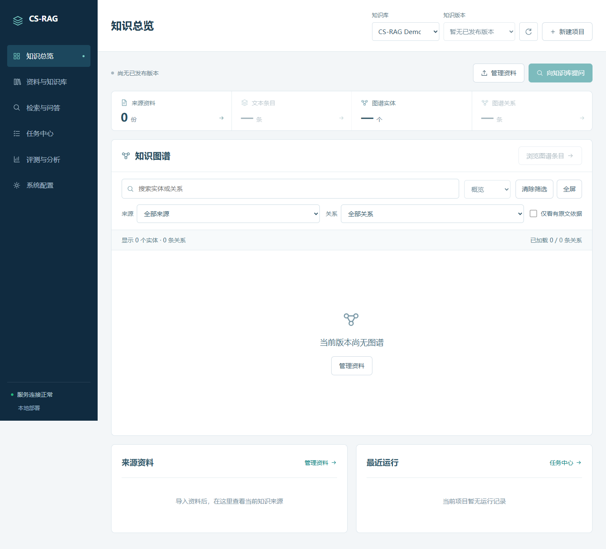

# CS-RAG

Source code for **Don't Worry About Quality: Robust Multi-Hop Retrieval despite Issues in Knowledge Graphs** (WWW 2027 manuscript).

## Repository Structure

```text
CS-RAG-reference/
|-- run.py                         Pipeline entry point
|-- configs/                       Execution and experiment configurations
|   `-- robustness_runner.yaml     Dataset paths, models, stages, and retrieval parameters
|-- components/
|   |-- query_plan_builder.py      LLM-based query planning
|   |-- phase1_run.py              Structural retrieval entry point
|   |-- phase1/                    Structural retrieval
|   |-- phase2_run.py              Text retrieval entry point
|   |-- phase2/                    Text retrieval
|   `-- eval_run.py                Answer generation and evaluation
|-- dataset/                       Raw questions, candidate passages, and gold annotations
|-- KGs/                           Extracted knowledge graphs
|-- planner_queries/               Saved query-planning results
|   |-- hotpotqa_data/              HotpotQA plans
|   |-- 2wiki_data/                 2WikiMultihopQA plans
|   `-- musique_data/               MuSiQue plans
|-- kg_extractors/                 KG construction scripts
|-- utils/                         Shared LLM, embedding, and metric utilities
|-- tools/                         Offline experiment utilities
`-- docs/paper_supplement/          Prompt templates and supplementary material
```

Run KG construction, query planning, then `run.py` for retrieval and QA evaluation.

## Environment

Current environment: Python 3.14.5. Required packages:

```text
torch==2.14.0
transformers==5.16.1
sentence-transformers==6.0.1
numpy==2.5.3
openai==3.8.0
tqdm==4.70.0
PyYAML==6.0.3
requests==2.34.2
```

Optional local model serving: vLLM in a separate Linux/WSL2 environment.

## HotpotQA Demo

The following commands start from `dataset/hotpotqa.json`, construct a new KG, generate query plans, and run retrieval and QA evaluation. Run all commands from the repository root in the same PowerShell session.

### 1. Choose the KG Builder

Use either a remote API or a locally served model. Both options use the same KG extraction commands in step 2.

#### Remote API

```powershell
$sampleCount = 1000
$env:OPENAI_API_KEY = "YOUR_API_KEY"
$env:OPENAI_BASE_URL = "YOUR_API_BASE_URL/v1"
$env:LLM_API_KEY = $env:OPENAI_API_KEY
$env:LLM_ENDPOINT = $env:OPENAI_BASE_URL
$env:LLM_BACKEND = "api"
$env:LLM_MODEL = "YOUR_KG_BUILDER_MODEL"
$env:OPENAI_MODEL = "YOUR_PLANNER_MODEL"
```

Replace the API and model placeholders. Use the same question count throughout the demo.

#### Local Qwen3-14B

Start the model service in Linux or WSL2:

```bash
vllm serve /path/to/Qwen3-14B --served-model-name qwen3-14b --host 127.0.0.1 --port 8000
```

Keep the server running. In the PowerShell session used for KG construction, select it with:

```powershell
$sampleCount = 1000
$env:LLM_BACKEND = "local"
$env:LLM_ENDPOINT = "http://127.0.0.1:8000/v1"
$env:LLM_MODEL = "qwen3-14b"
```

Keep the server running and replace the model path with your local directory. Set `LLM_LOCAL_API_KEY` if the server requires authentication.

### 2. Construct the KG

```powershell
python kg_extractors/llm_builder_hotpotqa.py `
  --data dataset/hotpotqa.json `
  --config configs/hotpot_local.yaml `
  --num_examples $sampleCount `
  --out KGs/KG_hotpotqa_demo
```

KG files are saved to `KGs/KG_hotpotqa_demo/`.

#### Use the Provided KG

To use the included HotpotQA KG, skip steps 1 and 2. Set the question count and continue with step 3:

```powershell
$sampleCount = 1000
```

In step 4, set `paths.kg_path` to `KGs/KG_hotpotqa` instead of `KGs/KG_hotpotqa_demo`. Use the provided query plans or generate new ones in step 3.

### 3. Generate Query Plans

Configure the planner API independently of the KG builder:

```powershell
$env:OPENAI_API_KEY = "YOUR_API_KEY"
$env:OPENAI_BASE_URL = "YOUR_API_BASE_URL/v1"
$env:OPENAI_MODEL = "YOUR_PLANNER_MODEL"
$env:DATASET = "hotpotqa"
$env:DATA_PATH = "dataset/hotpotqa.json"
$env:OUTPUT_FILE = "planner_queries/hotpotqa_data/query_graph_hotpotqa_demo.json"
$env:NUM_SAMPLES = "$sampleCount"
python components/query_plan_builder.py
```

#### Use the Provided Query Plans

To reuse the included HotpotQA plans, skip step 3 and set `paths.query_json` to `planner_queries/hotpotqa_data/query_graph_hotpotqa.json` in step 4.

### 4. Configure Retrieval and Evaluation

Copy the execution configuration:

```powershell
Copy-Item configs/robustness_runner.yaml configs/hotpotqa_demo.yaml
```

In `configs/hotpotqa_demo.yaml`, update the following fields while retaining the other configuration entries:

| Field | Demo value |
| --- | --- |
| `run.dataset` | `hotpotqa` |
| `run.max_samples` | The question count used in `$sampleCount` |
| `paths.raw_data_json` | `dataset/hotpotqa.json` |
| `paths.data_json` | `dataset/hotpotqa.json` |
| `paths.query_json` | `planner_queries/hotpotqa_data/query_graph_hotpotqa_demo.json` |
| `paths.kg_path` | `KGs/KG_hotpotqa_demo` |
| `paths.result_dir` | `outputs/hotpotqa_demo` |
| `global_env.OPENAI_API_KEY` | Your QA API key |
| `global_env.OPENAI_BASE_URL` | Your QA API base URL |
| `global_env.OPENAI_MODEL` | Your QA model name |

Enable `run.run_phase1`, `run.run_phase2`, and `run.run_evaluation`, and choose retrieval parameters using the table below. The runner reads the API settings from this configuration; these entries override the environment variables used during preparation.

### 5. Run Retrieval and Evaluation

```powershell
python run.py --config configs/hotpotqa_demo.yaml
```

Results are saved to:

```text
outputs/hotpotqa_demo/
|-- phase1_evidence.json
|-- phase2_evidence.json
|-- qa_results_with_recall.json
|-- phase1.log
|-- phase2.log
`-- evaluation.log
```

## Parameter Settings

Edit parameters in the configuration file passed to `run.py`. Parameter meanings and tuning ranges:

| Configuration entry | Meaning | Tuning range or valid choices |
| --- | --- | --- |
| `phase1.env.NEFF_THRESHOLD` | Sufficiency threshold (gamma). | `1.0-3.0`, in steps of `0.1`; smaller values are more selective. |
| `phase1.env.RELATION_K` | Number of structural candidates retained after relation matching (R). | `{6, 8, 10, 12, 14}` |
| `phase1.env.TOP_N_LLM` | Number of structural candidates retained after reranking (Ks). | `{1, 3, 5, 7, 9}` |
| `phase2.env.TOPK_UNRESOLVED` | Number of text passages retained after reranking per unresolved constraint (Kt). | `{1, 3, 5, 7, 9}` |
| `phase1.env.TOP_K_ENTITY` | Maximum candidate anchors per explicit entity. | Positive integer. |
| `phase2.env.UNRES_TOP_SIMILAR` | Number of text passages retained before reranking (Kt'). | Positive integer; choose at least Kt to allow that many final passages when available. |
| `phase1.env.EMB_MODEL`, `phase2.env.EMB_MODEL` | Embedding model for relation or passage similarity. | Compatible model identifier or local model directory. |
| `phase1.env.RERANK_MODEL`, `phase2.env.RERANK_MODEL` | Cross-encoder model for structural or text reranking. | Compatible model identifier or local model directory. |
| `phase1.env.EMB_DEVICE`, `phase2.env.EMB_DEVICE` | Device for embedding inference. | `cpu` or an available CUDA device such as `cuda:0`. |
| `phase1.env.RERANK_BATCH`, `phase2.env.RERANK_BATCH` | Reranker batch size. | Positive integer, limited by available memory. |

`run.max_samples` controls the query count; a nonpositive value processes all loaded query plans. Stage switches accept `true` or `false`; skipping a retrieval stage requires its existing output at the configured path. Configuration entries override the script defaults and inherited environment variables.

## System Overview

We construct a companion web interface for managing documents and knowledge-base versions, exploring knowledge graphs, and performing multi-hop question answering. It brings document import, knowledge construction, retrieval, and answer inspection into one workspace, with access to supporting evidence and execution records. The specifical contents are in `../system/`.

The screenshots below show a newly created project before documents are imported.

**Knowledge overview**



**Document and knowledge-base management**


**Retrieval and question answering**


