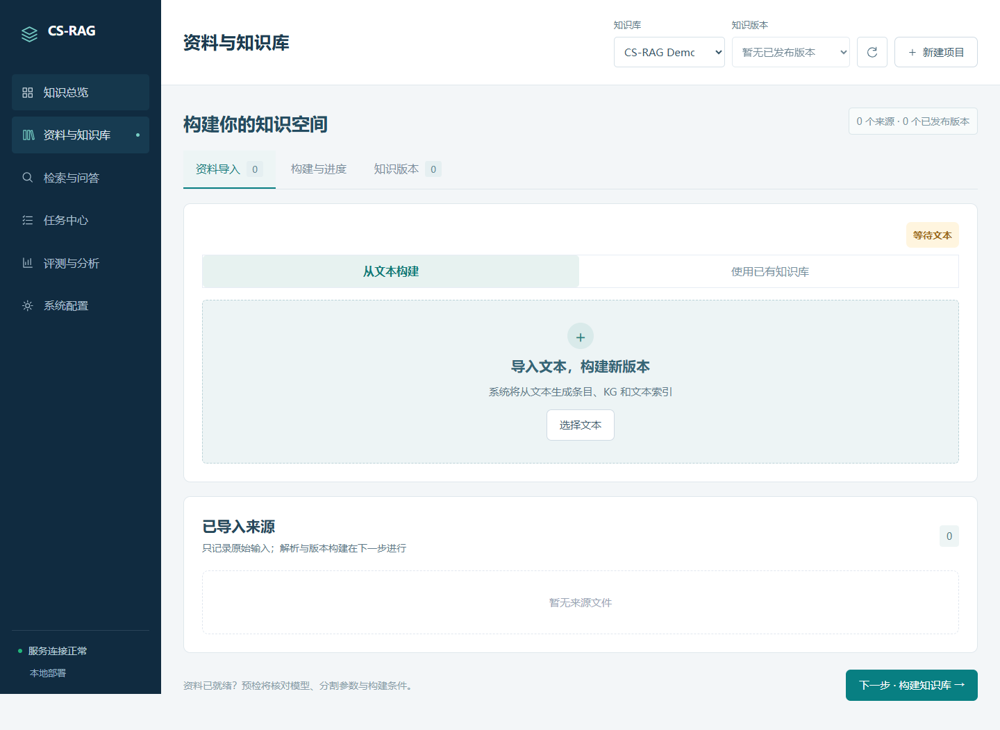
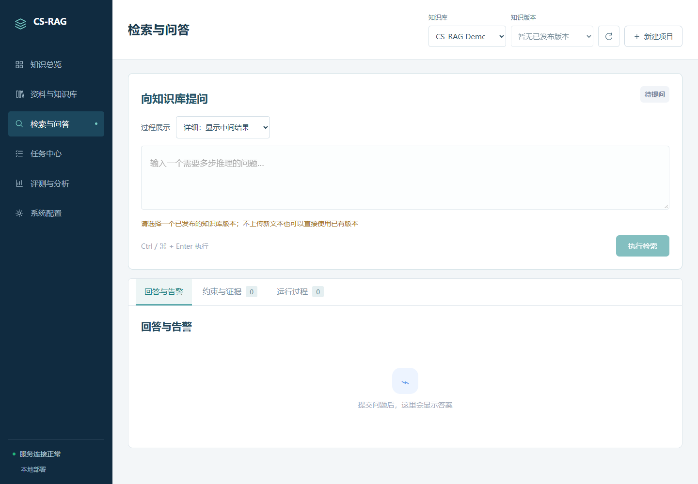

# CS-RAG

中文知识库构建与检索问答系统，支持文本上传、知识图谱构建、查询规划、证据展示与答案生成。

## 算法接入

将 `system` 放在 CS-RAG 算法目录下，保持以下结构即可：

```text
CS-RAG-reference/
├─ components/          # 查询规划、检索与回答算法
├─ kg/
├─ utils/
├─ docs/system/         # 界面截图
└─ system/              # 系统目录
   ├─ backend/
   ├─ frontend/
   ├─ scripts/
   └─ README.md
```

系统默认调用上一级算法目录，配置位于 `cs-rag-studio-v2.env`：

```dotenv
CS_RAG_REFERENCE_ROOT=..
CS_RAG_MODELS_ROOT=models
CS_RAG_DATA_ROOT=data
```

如果算法在其他位置，将 `CS_RAG_REFERENCE_ROOT` 改为算法根目录的绝对路径，该目录下应包含 `components/`。相对路径以 system 目录为基准。

系统依次调用 `components/` 下的 `query_plan_builder.py`、`phase1_run.py`、`phase2_run.py` 和 `eval_run.py`。接入代码位于 `backend/app/algorithm_adapter/`：`integration.py` 定义入口，`reference_runner.py` 负责调用，`contracts.py` 定义输入输出接口。

## 所需模型

| 类型 | 模型或服务 | 用途 |
|---|---|---|
| LLM | 支持 JSON 输出的 OpenAI-compatible 服务，可远程或本地部署 | KG 抽取、查询规划、答案生成 |
| Embedding | `BAAI/bge-small-zh-v1.5` | 语义切分与相似度计算 |
| Reranker | `BAAI/bge-reranker-v2-m3` | 候选证据重排 |

Embedding 和 Reranker 默认下载到本地，后续直接复用。LLM 的地址、模型名称和 API Key 在系统“设置”页填写。

## 安装与启动

准备 Python 3.11 或以上版本，在 `system` 目录打开 PowerShell。

### 1. 首次安装

已有兼容 Python 环境可以直接复用，否则创建项目环境：

```powershell
python -m venv .venv-csrag-system
.\.venv-csrag-system\Scripts\python.exe -m pip install --no-cache-dir -r requirements-release.txt

if (!(Test-Path cs-rag-studio-v2.env)) {
    Copy-Item cs-rag-studio-v2.env.example cs-rag-studio-v2.env
}
```

### 2. 下载模型

```powershell
.\.venv-csrag-system\Scripts\python.exe scripts/download_models.py
```

模型保存在：

```text
models/embedding/bge-small-zh-v1.5/
models/reranker/bge-reranker-v2-m3/
```

已有完整模型时，将配置中的 `CS_RAG_MODELS_ROOT` 指向已有 models 目录，可跳过下载。

### 3. 启动系统

```powershell
.\.venv-csrag-system\Scripts\python.exe -m uvicorn scripts.serve:app --host 127.0.0.1 --port 8000 --env-file cs-rag-studio-v2.env
```

浏览器打开 **http://127.0.0.1:8000/**。前端页面已构建，无需另外安装 Node.js。以后使用时重复启动命令即可，退出按 `Ctrl+C`。

进入“设置”页，填写 LLM 服务地址（通常以 `/v1` 结尾）、模型名称和 API Key，保存并测试连接。

## 使用流程

创建项目 → 上传文本 → 构建知识库 → 选择知识库版本 → 输入问题 → 查看查询规划、检索证据与答案。

模型与构建参数可在“设置”页调整，知识库及查询记录保存在 `data/`。

## 界面预览

### 知识库



### 检索问答


